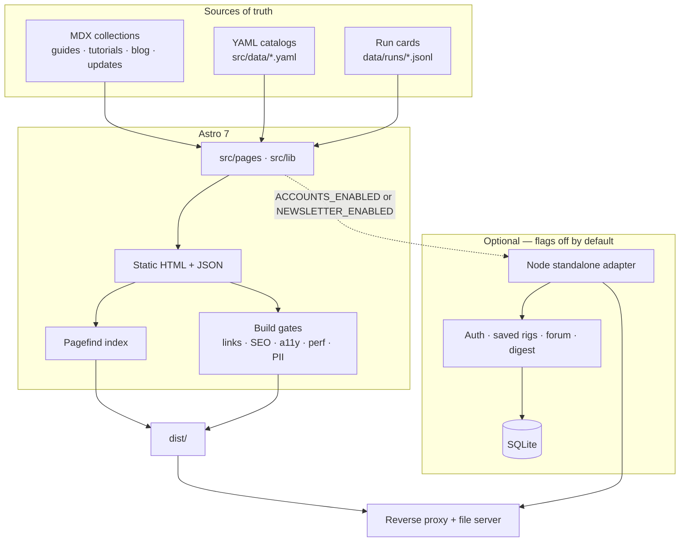

# AMDai

[](https://github.com/WillPowers3d/amdai/actions/workflows/ci.yml)
[](LICENSE)
[](package.json)

Independent lab notes for **local AI on consumer AMD Radeon and ROCm**.

**Live site:** [amdai.net](https://amdai.net)

[](https://amdai.net)

AMDai is a documentation site — not a store, not a leaderboard scrape, and not an AMD publication. It helps someone size a Radeon box, pick a GGUF and an engine, and follow a first-run path that is either **measured** on a published test rig or clearly labeled **cited** / **estimate**.

The wordmark is `AMDai` with a chip motif drawn for this project. **Not affiliated with AMD.** Product names are used nominatively.

## What the site does

The homepage is a living “what works this week” card, driven by dated YAML — not a frozen manual. Version pins are snapshots. Empty cells stay empty.

Around that card the repo ships:

| Area | What you get |
| --- | --- |
| **Path** | First-run setup (Ubuntu is the measured path; Windows, Fedora, Arch, WSL2, Docker, and app-specific guides are cited), recommended stacks, and per-GPU / per-model recipe sheets |
| **Tools** | Client-side quant + hardware calculator, GPU directory, model compare tables, budget tiers without invented prices, “can this Radeon run it?” fit pages |
| **Evidence** | Official `amdai-bench/run@1` cards under [`data/runs/`](data/runs/), a `/results` browser, and a `/benchmarks` hub that only prints measured or labeled cells |
| **Learn** | ROCm explainer, consumer ROCm problem tracker, symptom-first troubleshooter (including paste-a-log), harness catalog, shopper guides (KV cache, long context, MoE, image gen, speech, RAG, …) |

Default production is **static HTML**. Optional accounts, saved rigs, a forum, and an email digest exist in this repo but stay **off** unless feature flags are set.

## Key features

- **Evidence labels.** A number is a validating run card, a cited public doc with a URL and as-of date, or a labeled estimate. The build fails leftover `TODO` / `TBD` copy and invented Q1/Q2 quants.
- **House daily-driver path.** llama.cpp first (Vulkan on the published R9700 cards). Q5 preferred when the file fits. Q3 stays a labeled estimate unless measured. One LLM per GPU unless a page is explicitly about combining cards.
- **Test rig, published as-is.** Official cards credit a local desktop with two AMD Radeon AI PRO R9700 (32 GB, `gfx1201`), 256 GB DDR5, Ubuntu 24.04+. The motherboard model is not published. See [`/about`](https://amdai.net/about) and [`/methodology`](https://amdai.net/methodology).
- **Radeon Stack Lab companion.** Pages and `amdai-stack-lab:` deep links for an Ubuntu 24.04+ helper that records run cards. Packages are **not published yet** — this repo does not invent a download URL.
- **Static JSON.** `/api/v1/catalog.json`, per-GPU JSON, and a pick table are generated at build time. Query strings on those files are not evaluated.
- **Search and share cards.** Pagefind indexes `dist/` during `npm run build`. Per-page 1200×630 OG images live under `public/og/` (`npm run og` rebuilds the catalog).
- **QA as a build gate.** After compile: internal links + orphans, SEO/JSON-LD, axe-core in dark and light, a mobile Core Web Vitals / byte budget, and a PII denylist over `dist/`.

## Tech stack

| Layer | Choice |
| --- | --- |
| Site | [Astro](https://astro.build) 7, TypeScript, MDX content collections |
| Style | Tailwind CSS 4, self-hosted Geist / Geist Mono, dark-first theme ([`docs/design.md`](docs/design.md)) |
| Data | YAML catalogs in `src/data/`, JSONL run cards in `data/runs/`, Zod-checked collections |
| Search | [Pagefind](https://pagefind.app/) over the built site |
| Optional runtime | `@astrojs/node` standalone adapter, SQLite (Drizzle), magic-link / GitHub auth, SMTP |
| Quality | Node test runner (`tsx --test`), Playwright e2e, axe-core, custom SEO / perf / PII scripts |

Node **22.12+** (see `.nvmrc` and `package.json#engines`).

## Architecture

Content and catalogs compile to static pages. Feature flags can attach a small Node process for accounts, the digest, and the forum. Nothing in the default build needs a database.



**Forum** (`FORUM_ENABLED`) requires accounts and shares the same SQLite session. **Digest mailing** stays off unless `NEWSLETTER_SEND` is on *and* the digest command is passed `--send`. The default `npm run digest` only writes drafts under `artifacts/newsletter/`.

## Project structure

```text
.
├── data/runs/              Official amdai-bench/run@1 JSONL (committed)
├── docs/                   Design, OG, deploy cache notes, weekday scrape, schemas
├── e2e/                    Playwright
├── public/                 Fonts, favicons, OG PNGs, static JSON seeds
├── scripts/                Hub sync, screenshot helpers
├── src/
│   ├── components/         Astro UI (calculator, GPU sheets, nav, run cards)
│   ├── content/            MDX collections
│   ├── data/               Living YAML — edit these, not the layouts
│   ├── layouts/            Base, Doc, RocmGuide
│   ├── lib/                Domain logic + unit tests
│   ├── pages/              File-based routes (including optional /api)
│   ├── scripts/            QA gates, OG renderer, digest, notify
│   ├── server/             Accounts, forum, mail, CSRF — used when flags are on
│   └── styles/             Global Tailwind theme
├── astro.config.mjs        Site URL, redirects, Node adapter when flagged
└── .env.example            Documented flags and optional secrets (no real values)
```

Nav and IA live in [`src/lib/site.ts`](src/lib/site.ts). Calculator math is [`src/lib/calculator.ts`](src/lib/calculator.ts). Affiliate wrappers are [`src/lib/affiliates.ts`](src/lib/affiliates.ts) — buttons say “Check price”; the site does not print live or stale street prices.

### Living data files

| File | Feeds |
| --- | --- |
| `src/data/what-works.yaml` | Home status card |
| `src/data/stacks.yaml` | `/stacks` |
| `src/data/gpus.yaml` | GPU directory |
| `src/data/backends.yaml` | Engine comparison |
| `src/data/harnesses.yaml` | Frontends / agents |
| `src/data/version-matrix.yaml` | ROCm × engine × card (or “no data”) |
| `data/runs/*.jsonl` | Official run cards — schema in `docs/amdai-bench-run.schema.json` |

Add a dated note under `src/content/updates/` when a **line** changes (new Core SDK, new vLLM extras). Weekday procedure: [`docs/weekday-scrape.md`](docs/weekday-scrape.md).

## Run locally

```bash
npm install
npm run dev
```

The `dev` script binds to loopback on the port in `package.json` (43147). Copy [`.env.example`](.env.example) to `.env` only if you need optional flags or affiliate IDs. Leave flags at `0` for a pure static session.

```bash
npm test              # unit tests (tsx --test)
npm run build         # compile, Pagefind, then QA gates
npm run preview       # serve dist/ on the same loopback port
```

`npm run build` runs, in order: Astro → Pagefind → link/orphan QA → SEO QA → axe-core (dark + light) → mobile perf budget → PII denylist. Chromium is required for the a11y and perf gates (`npx playwright install chromium`).

Useful extras (not part of the default build):

| Command | Purpose |
| --- | --- |
| `npm run check` | `astro check` |
| `npm run test:e2e` | Playwright (expects a built `dist/`) |
| `npm run qa:links:external` | Outbound citation check — network, non-blocking for `build` |
| `npm run og` | Rebuild the OG PNG catalog |
| `npm run index` | Copy a Pagefind index into `public/pagefind` for `npm run dev` after a build |

Reports from the gates write under `artifacts/` and `reports/` (gitignored).

## Deployment

High level only — no hostnames, addresses, or secrets.

1. **Default path is static.** `ACCOUNTS_ENABLED=0`, `FORUM_ENABLED=0`, `NEWSLETTER_ENABLED=0` (the repo default) produces `dist/` with no database.
2. **`npm run build` is the release artifact.** HTML, hashed `/_astro/` assets, self-hosted fonts, Pagefind, sitemap, and static `/api/v1/` JSON all land in `dist/`.
3. **Serve `dist/` behind a reverse proxy** as a file root. Content-addressed `/_astro/` files and `/fonts/` can be cached as immutable. HTML, sitemaps, and the search index should revalidate so a new build is visible the same day.
4. **Canonical URLs** use `SITE_URL` when set; otherwise the `site` value in `astro.config.mjs` (`https://amdai.net`).
5. **Optional Node mode.** Turning on accounts or the newsletter switches Astro to the Node standalone adapter. That process needs a local env file (never committed), an `AUTH_SECRET` of at least 16 characters, and — if you want mail — SMTP settings from `.env.example`. Forum mode also requires accounts.

Do not commit `.env`, SQLite files, or real affiliate / auth tokens. `.env.example` is the documented shape.

## Accuracy

Product figures from AMD’s public pages are labeled. Publisher GGUF sizes are Hugging Face listings, not measured VRAM. ROCm and vLLM pins are **dated snapshots**. Re-check the live [ROCm matrix](https://rocm.docs.amd.com/projects/install-on-linux/en/latest/reference/system-requirements.html) and [vLLM GPU install](https://docs.vllm.ai/en/stable/getting_started/installation/gpu/index.html) before you treat a pin as current.

This repository does not invent tok/s, street prices, user counts, or a Stack Lab download URL.

## License

[MIT](LICENSE).
